<h1 align="center">Long Sunday</h1>

<p align="center">
  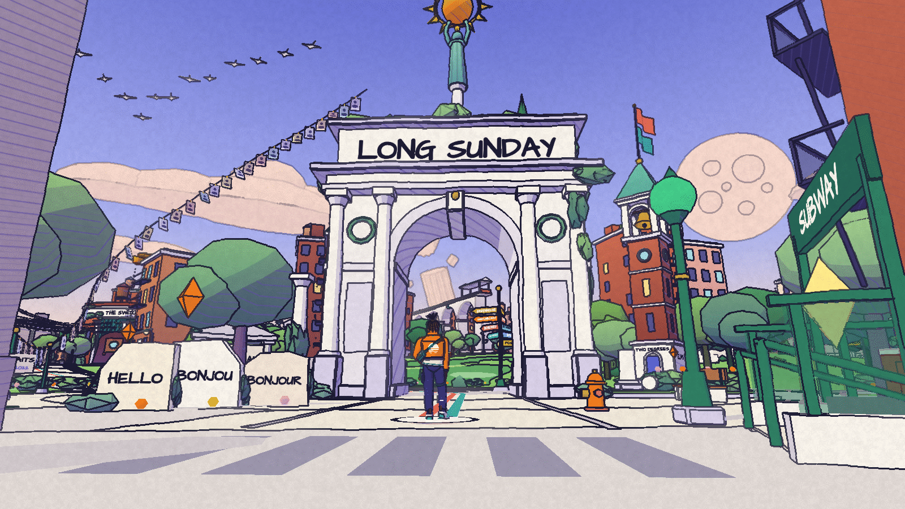
</p>

Long Sunday is my working life built as a small open world that runs in a browser tab. Nine years of technical recruiting sit along one road in date order, and the side roads lead to the things I built along the way, the ones that shipped and the ones that did not. It is drawn like a page from a Moebius comic, and one button shows the same place built in stone and brick and lit by a low sun.

I'm Dervin Dimanche.

Dimanche is French for Sunday.

I do these experiments for fun.

Live: LINK GOES HERE ONCE IT IS HOSTED

The hosted copy is behind a password. Ask me for it at dervindim@gmail.com.

## What you walk through

The world is a floating island about 470 metres across: a future Queens with Greek and Roman stone in it, grown over with green. One avenue runs uphill from the south, and every job I have held sits on it in date order, from a staffing desk in 2017 to an AI lab now. Two lines are set into the road like lines on a subway map, coral for people work and teal for technology, and they become one line at the top. Five side roads lead off the avenue to my experiments, the ones that failed, and the life outside work.

Each district has things to walk up to. Press E or tap the marker and a caption opens with what I did there, in my words, with links where the work is public. There are 58 captions in all, and every one of them lives in [src/content/content.ts](src/content/content.ts).

Some of the projects in the world are in private repositories. I describe them there, but they have no links.

<p align="center">
  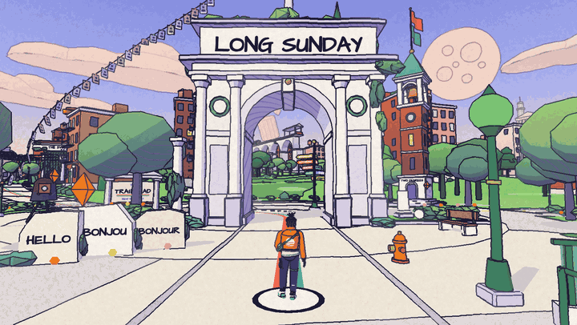
</p>

He walks through the arch at the Trailhead and up the avenue, the camera following behind him.

<p align="center">
  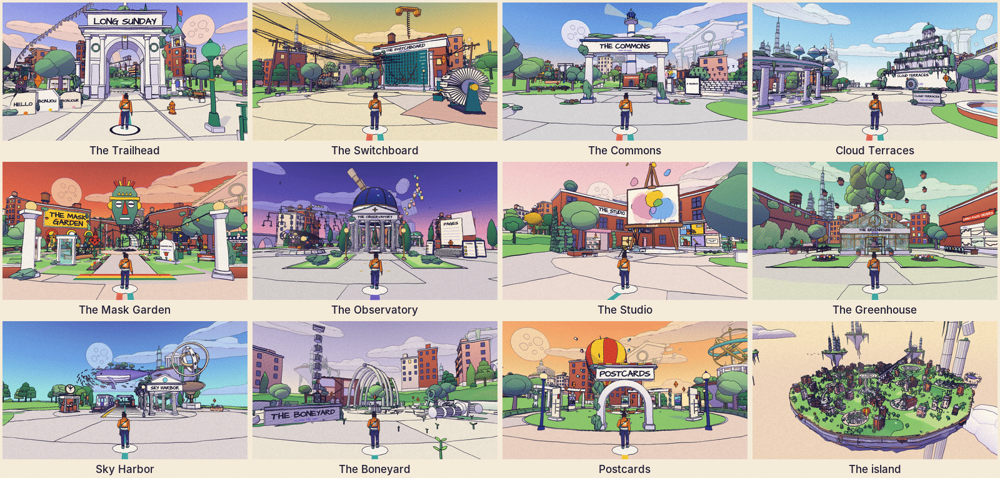
</p>

In walking order. The years and the road come from [src/world/layout.ts](src/world/layout.ts), the descriptions from [docs/PLAN.md](docs/PLAN.md).

| District | Years | Where | What it holds |
| --- | --- | --- | --- |
| The Trailhead | 2017 | Foot of the avenue | Where I start: New York, college, languages, the camera |
| The Switchboard | 2017 to 2019 | Avenue | TEKsystems, recruiter then account manager |
| The Commons | 2019 to 2021 | Avenue | Meta in Cambridge, interview prep, Black@Boston |
| Cloud Terraces | 2021 to 2023 | Avenue | Google Cloud, cleared hiring, L7 and L8, committees |
| The Mask Garden | 2023 to 2024 | Avenue | Diaspora DAO |
| The Observatory | 2024 to now | Top of the avenue | Microsoft AI |
| The Studio | 2023 to 2026 | Side road from the Commons | Backrun, Hon, Memory Visualizer, the 2023 notebook |
| The Greenhouse | 2026 | Side road from the Switchboard | Observable Lab, Research Lab, TradingOS |
| Sky Harbor | 2024 to 2026 | Side road from the Mask Garden | Krill, Ophanim, Empathy Archives |
| The Boneyard | Along the way | Side road from Cloud Terraces | What failed or never got finished, and what grew from it |
| Postcards | 2017 to now | Side road from the Trailhead | Travel and community |

<p align="center">
  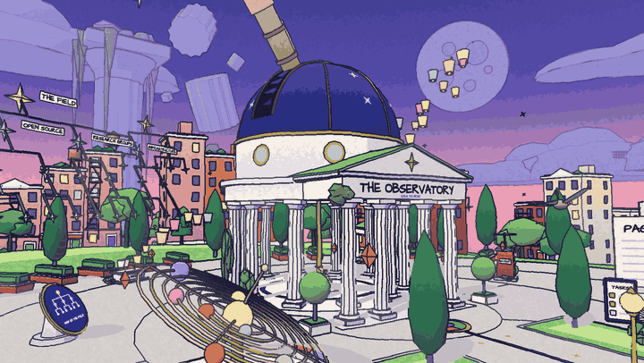
</p>

The Observatory at the top of the avenue. The orrery turns in front of the rotunda and the paper lanterns rise.

## How it is drawn

The drawing has no model files and no image files. Every building, tree, column and person is made in TypeScript from simple shapes (boxes, cylinders, lathes, extrusions), and a small kit merges the parts of each thing into one mesh, so a whole street can be one draw call. I went with code over model files because every part has to carry what the ink pass needs: its colour, its outline group, how much it hatches and how much it sways. [docs/KIT.md](docs/KIT.md) has the kit.

Everything is drawn with one material, then inked by one full screen pass. That pass finds edges in depth, in the direction a surface faces and in an object id, and draws an indigo line of the same weight near and far, with a slight wobble. Light falls in two or three flat bands of colour. Shade is violet hatching that gets denser where a form turns away from the sun. The sky is a three stop gradient behind everything, each district has its own, and far things fade into haze before they lose their outline.

The lettering is drawn into the world. Signs, plates and district names are set in Architects Daughter, one glyph at a time, into one 1024 pixel atlas made when the page loads, and each letter bobs and tilts a little so it reads as hand lettered. An atlas of whole strings for four hundred signs would have wanted a 4096 pixel texture.

<p align="center">
  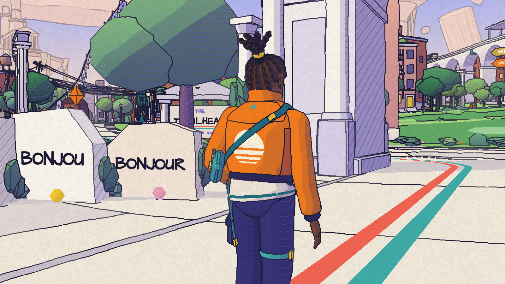
  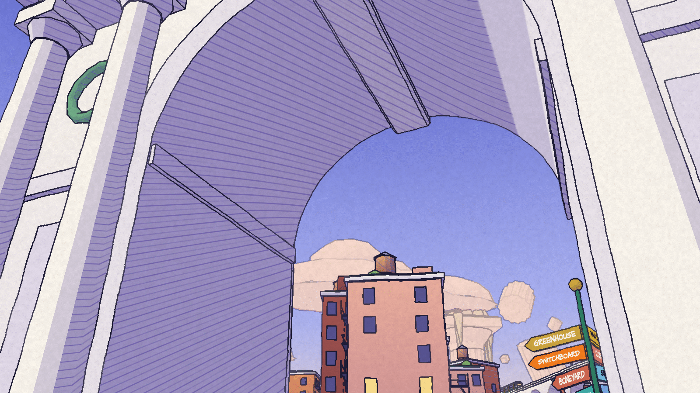
  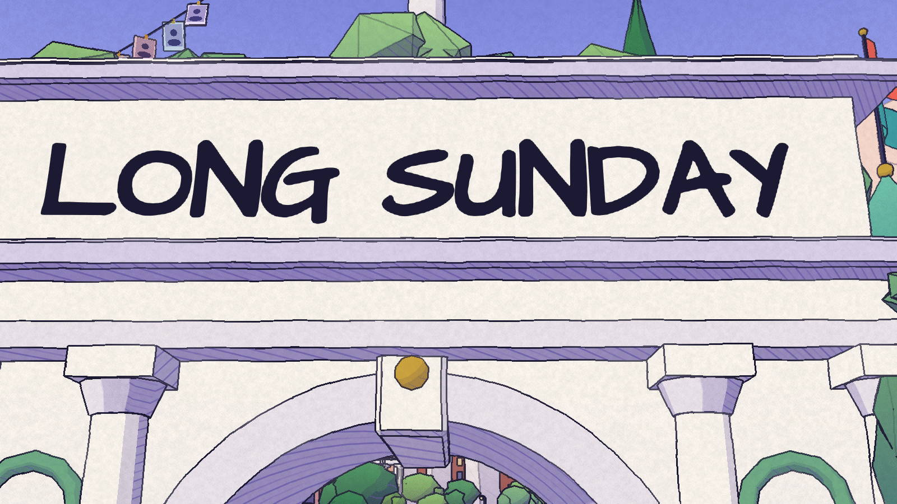
</p>

Close up: the ink line round him and the two lines in the road, the hatching inside the arch's vault, and the lettering on the arch.

The figure is a Black teenager in an oversized orange jacket, with rope twists tied up high, dark cargo trousers and chunky white trainers. He is built in code like everything else, from twelve meshes, with his own idle, walk and run ([src/engine/character.ts](src/engine/character.ts)). The design is original.

<p align="center">
  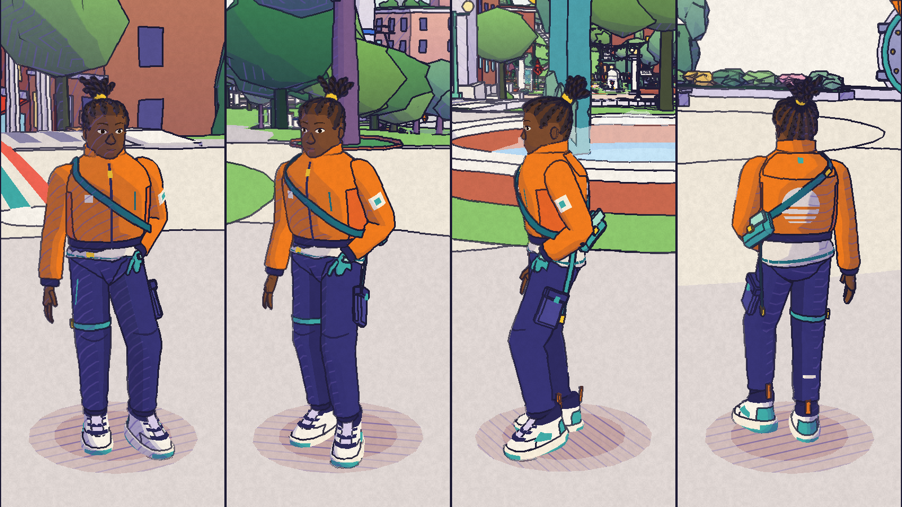
</p>

## The built version

The same world has a second look. A button in the top bar says Drawn and Built, and L on a keyboard does the same thing. The drawing is the blueprint. The built version is the place made from it in marble, brick, brass and grass, as if someone had built it and photographed it late on a clear afternoon. The switch happens where you stand: same spot, same camera, and the walk goes on. The picture crosses over in 0.6 seconds, spreading out from him.

<p align="center">
  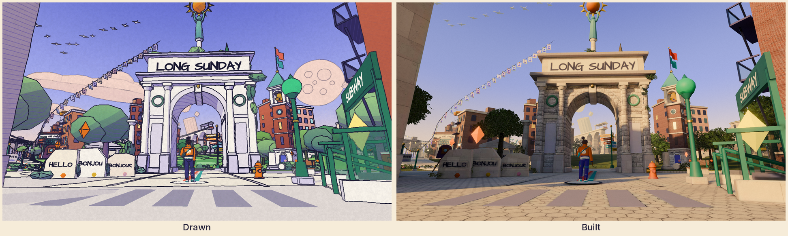
</p>

<p align="center">
  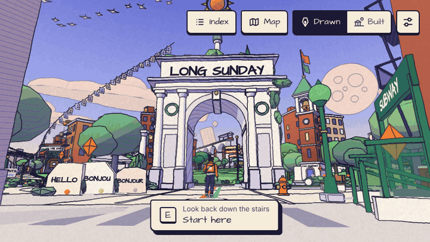
</p>

The camera holds still while the switch in the corner turns the drawing into the built version and back.

The drawing is all code. The built version is baked once, offline, in Blender, from the drawing's own geometry. A script opens the running page in headless Chromium and writes every mesh that does not move into glTF, one chunk per district plus the ground, the city and the far sky. Blender sorts each surface into a real material by its colour and shape (rules in [tools/real/materials.json](tools/real/materials.json)), bevels the stone, turns the round tree crowns into leaf cards, and path traces the light once with Cycles into lightmaps. The browser only shows the result, with standard three.js materials: a lightmap on the second UV set, tiling textures on the first, and a sky picture for reflections. Nothing baked moves, so the figure, the markers, the train, the whale and the flags keep the drawing's shapes with a real surface, lit by one sun and one sky light.

The surface textures are twelve CC0 sets from Poly Haven and ambientCG, sized down and packed by the pipeline. Each one is credited in [public/real/CREDITS.md](public/real/CREDITS.md).

None of these files load until a visitor chooses Built. Then the page fetches the sky, the ground, the city and the far sky, and the district nearest him, and the rest stream in by distance, nearest first. Until a district's files arrive it is drawn from the drawing's geometry with a stand-in material, so there is never a hole. Phones, and any device that reports 4 GB of memory or less, get half size lightmaps and textures. The choice is kept for the next visit.

<p align="center">
  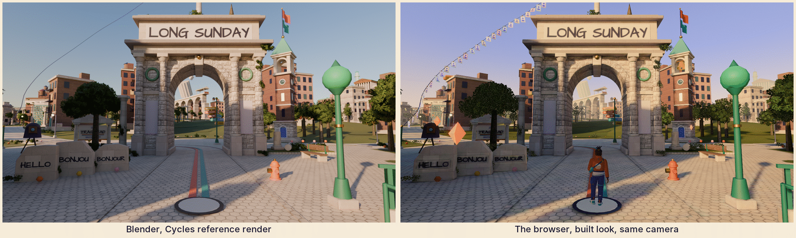
</p>

Left, the picture Cycles rendered from the Trailhead's arrival camera. Right, the browser's built look from the same camera. He is only on the right because he moves, so he is not baked.

The first browser version had shade 20 to 35% brighter than the Cycles pictures. The lightmaps were right. The cause was three.js's fitted AgX tone curve, so the bake now ships Blender's own AgX as a lookup table, and with it shade sits within 2 to 4% of the Cycles picture on the cameras I compared. [docs/REAL.md](docs/REAL.md) has the measurements.

What it costs, from [docs/REAL.md](docs/REAL.md), measured in headless Chromium at 1280 by 720 on the high tier:

| What | Size or count | Ceiling |
| --- | --- | --- |
| Everything in `public/real/` | 21.4 MB | 60 MB |
| Base set: ground, city, far sky | 7.4 MB | 10 MB |
| Shared textures and sky | 3.1 MB | 6 MB |
| Largest district with its lightmap (the Mask Garden) | 1.0 MB | 4 MB |
| Built look's code, fetched on the first switch | 28.1 kB gzipped | |
| Added to the drawing's first download | 2.9 kB for the switch, 3.2 kB for the button, gzipped | |
| Heaviest frame measured (the overview) | 248 draw calls, 676,048 triangles | 250 and 700,000 |
| Graphics memory, everything loaded | 332 MB on high | 340 MB high, 230 medium, 100 low and phones |

The drawing pays next to nothing for any of this. Before the first switch the page makes 62 requests and none of them is for the built look. Four drawn pictures came out the same files, byte for byte, as they were before the built version existed.

### Rebuild it

The system Blender here is 4.0.2, which has no denoiser and no numpy, so the pipeline runs Blender 4.2 as a Python module in an environment of its own. That is about 1 GB, set up once:

```bash
python3.11 -m venv tools/real/cache/venv
tools/real/cache/venv/bin/pip install bpy==4.2.23 pillow
```

Then one command exports, fetches the textures (about 140 MB the first time), bakes and packs:

```bash
npm run real:all
```

The export needs Playwright installed globally with its Chromium, as the screenshot script does. A full bake took 62 minutes on a four core machine with no graphics card. After that only the chunks that changed bake again. [docs/REAL.md](docs/REAL.md) has every step, the file contract and what still gives the built version away.

## How it stays light

The budget for the drawing, and what `node scripts/shot.mjs --tour` measured with all eleven districts built ([docs/DEV.md](docs/DEV.md)):

| What | Budget | Measured, high tier, 1280 by 720 |
| --- | --- | --- |
| Draw calls in the frame | under 150 | 43 to 75 at the arrival points, 79 from the overview |
| Triangles in the frame | under 400,000 | 161,000 to 350,000 at the arrival points, 376,000 from the overview |
| One district | 12 draw calls, 40,000 triangles | heaviest are Sky Harbor at 9 and 38,400, the Mask Garden at 7 and 36,800 |

The world keeps the frame inside that by itself. Each frame it sorts the districts by distance, skips the ones off screen, and draws the nearest until the next one would break the budget. Districts past a set distance are dropped and the haze closes in to match, so they arrive pale. Three quality tiers decide how much gets built:

| | low | medium | high |
| --- | --- | --- | --- |
| Districts drawn out to | 250 m | 330 m | 440 m |
| Triangle budget | 260,000 | 320,000 | 400,000 |

The tier also sets the terrain detail, how much city and how many clouds there are, and how detailed each district and the figure are. Resolution drops when frames run slow and climbs back when there is room. Phones and tablets start at a pixel ratio of 1.

Download sizes from a fresh `vite build`:

| File | Size | Gzipped |
| --- | --- | --- |
| Main script: engine, interface, captions, three.js | 796 kB | 239 kB |
| Style sheet | 38 kB | 7.5 kB |
| One script per district, fetched while the title card is up | 17 to 36 kB | 6.6 to 14.0 kB |
| Lettering font, woff2 | 13 kB and 7 kB | |
| Built look's code, only on the first switch | 80 kB | 28.1 kB |
| `npm run build:single`, everything in one HTML file | 1.25 MB | 416 kB |

## How I made it

I wrote the plan first: the concept, the districts and what stands in each, the art direction and the budgets ([docs/PLAN.md](docs/PLAN.md)). The work then went in separate pieces, each with its own budget and checked against its own screenshots: the engine, the city between the districts, the eleven districts one at a time, and the interface. Then I ran a review pass: a flood fill over every collider on a 25 cm grid to make sure every road, arrival point and caption can be reached on foot, an art pass over every district, a code pass, a check of every caption against my resume and notes, and an interface pass driven by script at desktop and phone sizes. A fix pass closed what the reviews found, and the built version went the same way, with its own written contract in [docs/REAL.md](docs/REAL.md). The review scripts were throwaway and are not in the repository, but the screenshot tool (`scripts/shot.mjs`) and the script that made the loops on this page (`scripts/film.mjs`) are.

## Tools

I actively use Codex, Claude, DeepSeek through Hermes, and Kimi to experiment and develop Long Sunday. They help me try implementations, debug problems, inspect ideas, and review changes.

It is written in TypeScript with three.js 0.180 and built with Vite. The drawing has no model or texture files: everything in it is drawn in code. The built version's files are made from the drawing in Blender. The lettering font is Architects Daughter.

## Walk it

- Keyboard: WASD or the arrow keys to walk, Shift to run, E to look closer, M for the map, L for Drawn or Built, Esc to close.
- Mouse: drag to look.
- Phone: left thumb to walk, drag anywhere else to look, tap a marker to look closer.
- A gamepad works if one is connected.

Short on time? Choose **Read the index** on the title card. It lists everything in the world on one page. The settings have a choice that stills the decoration for anyone who prefers less motion, and the page follows the system setting for that when it opens.

<p align="center">
  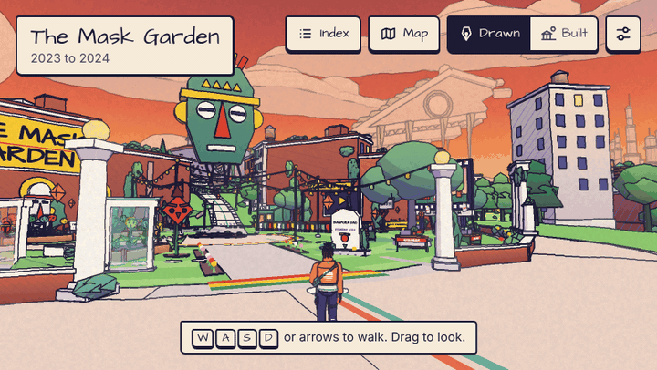
</p>

He walks up to the founder's stone in the Mask Garden, the prompt comes up, and the caption opens and closes.

<p align="center">
  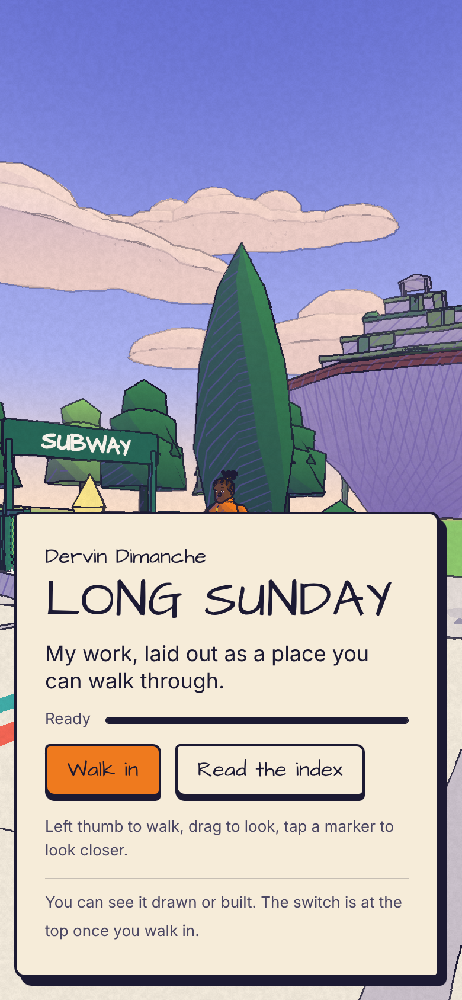
  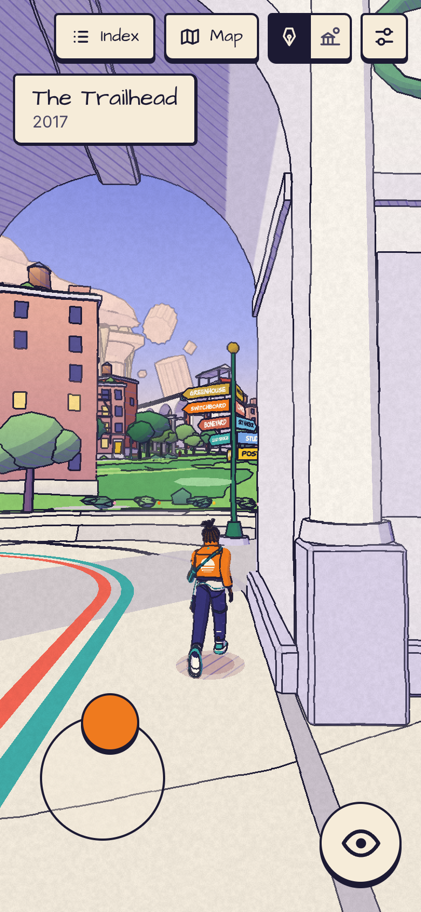
</p>

The title card and walking, in a phone sized window of 390 by 844.

## Run it

```bash
npm install
npm run dev            # http://localhost:5173
npm run build          # dist/, a static folder that works from any path, built version under dist/real/
npm run build:single   # dist-single/index.html, one self-contained file
```

The single file holds the whole drawing and opens straight from disk. It cannot show the built version, whose files need a server, so there the switch is hidden. Address switches for working on it (`?d=studio`, `?q=low`, `?debug=1` and more) and the screenshot tool are in [docs/DEV.md](docs/DEV.md).

### The locked copy, and hosting it

The copy that goes on a public address is locked with a password:

```bash
read -rs LONG_SUNDAY_PASSWORD && export LONG_SUNDAY_PASSWORD
npm run build:locked   # dist-locked/index.html
```

The password comes from the environment only, has to be 12 characters or more, and is never printed or written down. The script gzips the single file build and seals it with AES-256-GCM under a key made from the password with PBKDF2 (600,000 rounds), so view source shows only an unlock page and a block of sealed text. The built version's files are sealed with the same key.

- Vercel: import the repository and add `LONG_SUNDAY_PASSWORD` as an environment variable. [vercel.json](vercel.json) already says what to build and serve.
- GitHub Pages: add `LONG_SUNDAY_PASSWORD` as a repository secret, set Pages to deploy from GitHub Actions, and run the "Deploy locked copy to Pages" workflow by hand. Pages from a private repository needs a paid plan.

The lock is exactly as strong as the password, and anyone who has it can pass it on. Once this repository is public, every caption can be read here in plain text, so the lock then guards only the hosted link. The section "The locked copy" in [docs/DEV.md](docs/DEV.md) has the one click link, "Stay unlocked" and the rest of the limits.

## What is in the repository

| Folder | What it holds |
| --- | --- |
| `src/engine/` | The renderer and ink pass, the kit, terrain, sky, the city between districts, the figure, the controls, and the world that loads and culls it all |
| `src/districts/` | One file per district |
| `src/content/` | Every caption |
| `src/world/` | The map and the palette |
| `src/ui/` | Title card, captions, index, map, settings and the Drawn and Built switch |
| `src/real/` | The built version in the browser, and the export hook the pipeline uses |
| `src/lock/` | The unlock page |
| `public/real/` | The built version's files and their credits |
| `tools/real/` | The Blender pipeline |
| `tools/character/`, `dev/` | Test pages for the figure, the kit and the land |
| `scripts/` | Screenshots, the loops on this page, and the lock |
| `docs/` | The plan, the kit, working notes, the built version's pipeline, and the pictures here |

## What I have not verified

The counts and pictures on this page came from headless Chromium drawing in software, where frame rates mean nothing. Draw calls, triangle counts, file sizes and pictures were measured. These were not:

- Frame rate on real hardware, laptop or phone.
- A real phone. The phone checks ran in a phone sized window with touch, in Chromium.
- Safari and Firefox. Only Chromium was used.
- The built version on a real graphics card: how long the first switch takes (26 to 40 seconds in software here), and how memory holds up on real devices against the ceilings above.
- A screen reader, by ear.
- The GitHub Pages workflow and a Vercel build. Neither has been run yet.
- A stale bake. When a district changes inside a mesh the bake already covers, the built version shows the old shape until that district is baked again, and nothing warns about it.
